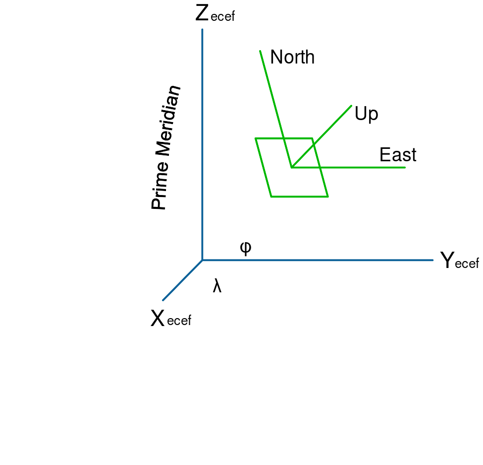

# NATO C-UAS Data Challenge

El ETL está en la raíz de este repo: `src/`, `config.yaml`, `requirements.txt`, `.venv`, `data/`, `reports/` y `out/`. El visor 3D está en `visualization/`.

## Datos

Cada miembro debe copiar los datasets originales dentro del repo, no enlazarlos desde otra ruta del PC:

```text
data/raw/test/  <- copia de Testing datasets
data/raw/eval/  <- copia de Evaluation datasets
```

`data/raw/` y `data/interim/` están ignorados por git; solo se versiona `data/README.md`.

## Convención de coordenadas

Hay dos sistemas y no se deben mezclar:

- Interno (ETL, tracker y visor): ENU/NEU (East-North-Up / North-East-Up: ejes locales en metros, tangentes al elipsoide WGS84 en el origen; ENU ordena Este, Norte, Arriba y NEU ordena Norte, Este, Arriba) con un origen fijo por iteración (un punto de referencia lat/lon/alt para pasar de WGS84 a metros locales). Ese origen es la mediana de las posiciones de sensor y se guarda en `data/interim/origins.json`.
- Entrega (Excel): WGS84 geodésico (WGS84: sistema geodésico mundial; `latitude`, `longitude`, `altitude_m`: grados y metros sobre su elipsoide) y covarianza NEU (matriz 3×3 de varianzas y covarianzas en ejes Norte-Este-Arriba, en m²) centrada en cada state vector (vector de estado: la posición estimada del dron en un instante, `[lat, lon, alt]` o `[n, e, u]`, junto con su incertidumbre), tal como pide `README_SubmissionTemplate.pdf` §1.2.

Cómo se calculan: en `src/geo.py` se pasa de WGS84 a ECEF (Earth-Centered, Earth-Fixed: coordenadas cartesianas 3D centradas en la Tierra, en metros) y de ahí a ENU/NEU rotando al plano tangente del origen. El template oficial describe la conversión de incertidumbre con el Jacobiano (matriz de derivadas parciales WGS84 → ECEF → NEU).



*Figura 1. ECEF (X, Y, Z) y ejes locales ENU. Fuente: [Mike1024, dominio público, Wikimedia Commons](https://commons.wikimedia.org/wiki/File:ECEF_ENU_Longitude_Latitude_relationships.svg).*


*Figura 2. ECEF y ejes locales Norte/Este/Arriba. Fuente: [Kkddkkdd, CC BY-SA 4.0, Wikimedia Commons](https://commons.wikimedia.org/wiki/File:ECEF_ENU_Longitude_Latitude_right-hand-rule.svg).*

NEU es el mismo esquema que ENU cambiando el orden de los ejes: `N-E-U` en vez de `E-N-U`.

Por qué se hace así:

- El tracker trabaja mejor en metros locales: Kalman, gating y covarianzas son más estables y comparables dentro de una iteración.
- El Excel no admite ese ENU interno: exige WGS84 y una covarianza NEU referida a cada state vector, no al origen fijo de la iteración.
- Por eso el ETL y el tracker usan ENU por iteración, pero `src/submit.py` convierte de vuelta con `enu_to_geodetic` (pasa ENU local a lat/lon/alt WGS84) y `covariance_neu_to_neu` (rota la covarianza NEU del origen de iteración al NEU de cada state vector) antes de escribir.

El origen por iteración es **decisión nuestra**, no una regla del concurso. La regla oficial es el formato de salida: WGS84 + NEU por state vector.

En los datos actuales, `S3` tiene tres iteraciones (`I1`, `I2`, `I3`) y sus orígenes difieren menos de 4 m, así que usar un origen por iteración es equivalente en la práctica a usar uno por escenario. Si en el futuro las iteraciones de un escenario se separan mucho, conviene pasar a origen por escenario o usar features relativas.

Verificación de la conversión interna → Excel:

```bash
python scripts/verify_submission.py
```

El script recorre las 9 plantillas, mockea tracks en ENU, los convierte a WGS84 + NEU por state vector, escribe un Excel real por iteración y comprueba cabecera, timestamps, covarianza y round-trip. Verificado: 9/9 plantillas pasan.

## Entorno

```bash
uv venv --python 3.11 .venv
source .venv/bin/activate
uv pip install -r requirements.txt
```

## Rehacer la base de datos

```bash
python -m src.cli all
```

Equivale a ejecutar, en orden:

```bash
python -m src.cli inventory # reports/inventory.csv y resumen
python -m src.cli etl       # data/interim/*
python -m src.cli splits    # folds sin fuga (leave-one-iteration-out: cada fold valida con una iteración completa y entrena con las demás, sin compartir vuelo)
python -m src.cli check     # valida plantillas Excel
```

Para reconstruir desde cero:

```bash
rm -rf data/interim reports out
python -m src.cli all
```

## Documentación de la base de datos

Detalle del ETL, esquema común, columnas, tablas, calidad y limitaciones: [`data/README.md`](data/README.md). Checklist completo de tratamientos de raw a interim: [`data/README.md#checklist-etl-de-raw-a-interim`](data/README.md#checklist-etl-de-raw-a-interim).

Salidas: `data/interim/` (tablas Parquet), `reports/` (auditoría y métricas) y `out/` (Excel de entrega).

## Train / validación

- `test` = 6 iteraciones con ground truth → entrenamiento/validación supervisada.
- `eval` = 3 datasets sin ground truth → solo inferencia; nunca entrenar ni calibrar con ellos.
- Dividir las **detecciones** (filas) por `split_group` (iteración completa), nunca por fila individual: todas las filas de una iteración van juntas a train o a validación. `data/interim/splits.json` ya trae 6 folds leave-one-iteration-out sin solape, y `reports/split_folds.csv` permite auditarlo.

Por qué: las filas de una misma iteración comparten vuelo, sensores y tiempo. Un split por fila metería el mismo dron/instante en train y validación, inflando las métricas. Separando por iteración, se valida en un vuelo/escenario no visto.

- Ajustar escaladores, calibración y umbrales solo con folds de train; congelar antes de `eval`.
- `fusion` (`LJJX`) es solo de test: excluirlo o marcarlo con `is_fusion_node` / `is_test_only` para evaluación.
- La lista de amigos solo sirve para identidad en inferencia.

## Visualización

El visor 3D está en [`visualization/`](visualization/README.md). Se ejecuta aparte, con sus propias dependencias y una carpeta plana de CSV:

```bash
cd visualization
pip install -r requirements.txt
python app.py --data /ruta/a/csv
```

## Configuración

Todos los parámetros están en `config.yaml`.

## TODO

Hecho: Fases 0-2 de la guía (repo, inventario y ETL). Pendiente:

- Valorar hacer la asociación y el tracker (Fases 3-4): decidir gating, húngaro y triangulación solo-azimut; montar Kalman con ciclo de vida; y elegir si empezar por un baseline solo-cyber para desbloquear el 60%.
- Hacer el evaluador propio (Fase 5): calcular GOSPA, recall de clase/identidad y acierto de metadatos en `src/evaluate.py`.
- Resolver clasificación, identificación y metadatos (Fases 6-8): votar por track, decidir amigo/enemigo por serial y rellenar la ficha técnica (modelo, protocolo, banda).
- Ajustar y calibrar (Fase 9): cambiar un parámetro a la vez, congelar `config.yaml` y fijar umbrales con FPR objetivo usando folds de test.
- Dejar hecha la entrega (Fase 10): generar los 3 Excel de evaluación, escribir el PDF de metodología y montar la demo.
- Añadir tests automáticos con pytest.
- Crear el documento compartido (p. ej. Drive) con brainstorming de familias de modelos por tarea (tracking, clasificación, identificación, metadatos y fusión), incluyendo **prefiltro** de datos, **postfiltro** de tracks estimados con funciones analíticas y heurísticas (decidir cuáles usar), **feature engineering**, reglas analíticas, tratamiento de datos de sensores, **modelos**, reducción/filtrado de datos, zoo de candidatos, **SOTA** e ideas a mantener/descartar.
