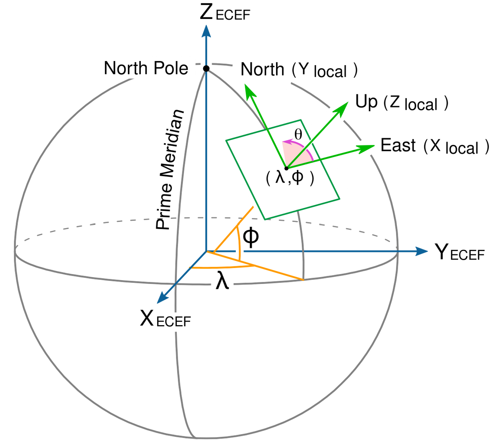
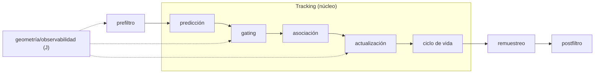

# NATO C-UAS Data Challenge

El ETL está en la raíz de este repo: `src/`, `config.yaml`, `requirements.txt`, `.venv`, `data/`, `reports/` y `out/`. El visor 3D está en `visualization/`.

## Pipeline de extremo a extremo

Diagrama de flujo interactivo y simplificado: desde los CSV originales hasta el Excel de entrega, con ETL, sistema ENU, prefiltro, asociación, tracker, postfiltro, clasificación, identificación, metadatos, evaluación y visor 3D. Los nodos enlazan a `src/`, `data/` y `visualization/`.

```mermaid
flowchart LR
    subgraph DATOS["Datos y ETL"]
        direction TB
        RAW["Datos originales<br/>CSV · GT · amigos · plantillas"]
        INV["Inventario<br/>Scenario/Iteration · split_group"]
        NORM["Normalización<br/>tiempo · sensor · coords · clase · serial · metadatos"]
        ENU["Sistema ENU<br/>origen = mediana de sensores<br/>WGS84 → ECEF → ENU"]
        DEDUP["Dedup SHA1<br/>Parquet · origins.json"]
        INT["Interim<br/>detections · GT · friends"]
    end
    subgraph TRACKING["Tracking"]
        direction TB
        SPL["Splits<br/>LOO por iteración"]
        PRE["Prefiltro<br/>inválidos · 0,0 · fusion · saltos"]
        ASO["Asociación<br/>gating · Húngaro · azimut"]
        TRK["Tracker<br/>Kalman ENU · lifecycle"]
        POST["Postfiltro<br/>plausibilidad · suavizado"]
    end
    subgraph ATRIBUTOS["Atributos"]
        direction TB
        CLS["Clasificación<br/>voto por track"]
        IDN["Identificación<br/>serial vs amigos"]
        MET["Metadatos<br/>modelo · protocolo · banda"]
    end
    subgraph ENTREGA["Evaluación y entrega"]
        direction TB
        EVA["Evaluación<br/>GOSPA · recalls"]
        SUB["Submit<br/>ENU → WGS84 · NEU"]
        XLS["Excel<br/>19 columnas · 100 ms · check"]
    end
    VIS["Visor 3D<br/>CSV planos"]

    RAW --> INV --> NORM --> ENU --> DEDUP --> INT
    INT --> SPL --> PRE --> ASO --> TRK --> POST
    POST --> CLS --> IDN --> MET --> EVA --> SUB --> XLS
    INT --> VIS
    VIS -.-> TRK

    click RAW "data/README.md" "Datos originales"
    click INV "src/etl.py" "Inventario y ETL"
    click NORM "src/etl.py" "Normalización"
    click ENU "src/geo.py" "Sistema ENU"
    click DEDUP "src/etl.py" "Deduplicación"
    click INT "data/README.md" "Tablas interim"
    click SPL "src/splits.py" "Splits"
    click PRE "config.yaml" "Prefiltro"
    click ASO "src/associate.py" "Asociación"
    click TRK "src/tracker.py" "Tracker"
    click POST "config.yaml" "Postfiltro"
    click CLS "src/classify.py" "Clasificación"
    click IDN "src/identify.py" "Identificación"
    click MET "src/metadata.py" "Metadatos"
    click EVA "src/evaluate.py" "Evaluación"
    click SUB "src/submit.py" "Submit"
    click XLS "out/" "Excel de entrega"
    click VIS "visualization/README.md" "Visor 3D"
```



## Datos

Cada miembro debe copiar los datasets originales dentro del repo, no enlazarlos desde otra ruta del PC:

```text
data/raw/test/  <- copia de Testing datasets
data/raw/eval/  <- copia de Evaluation datasets
```

`data/raw/` y `data/interim/` están ignorados por git; solo se versiona `data/README.md`.

## Convención de coordenadas

Hay dos sistemas y no se deben mezclar:

- Interno (ETL, tracker y visor): ENU/NEU (East-North-Up / North-East-Up: ejes locales en metros, tangentes al elipsoide WGS84 en el origen; ENU ordena Este, Norte, Arriba y NEU ordena Norte, Este, Arriba) con un origen fijo por iteración (un punto de referencia lat/lon/alt para pasar de WGS84 a metros locales). Ese origen es la mediana de las posiciones de sensor y se guarda en `data/interim/origins.json`.
- Entrega (Excel): WGS84 geodésico (WGS84: sistema geodésico mundial; `latitude`, `longitude`, `altitude_m`: grados y metros sobre su elipsoide) y covarianza NEU (matriz 3×3 de varianzas y covarianzas en ejes Norte-Este-Arriba, en m²) centrada en cada state vector (vector de estado: la posición estimada del dron en un instante, `[lat, lon, alt]` o `[n, e, u]`, junto con su incertidumbre), tal como pide `README_SubmissionTemplate.pdf` §1.2.

Cómo se calculan: en `src/geo.py` se pasa de WGS84 a ECEF (Earth-Centered, Earth-Fixed: coordenadas cartesianas 3D centradas en la Tierra, en metros) y de ahí a ENU/NEU rotando al plano tangente del origen. El template oficial describe la conversión de incertidumbre con el Jacobiano (matriz de derivadas parciales WGS84 → ECEF → NEU).

ENU es una aproximación tangente local: es válida para el escenario (unos pocos km) y no para distancias globales; para un uso global se usaría WGS84 o ECEF. En estos datos el ground truth real está dentro de ±4 km, así que el error de curvatura es despreciable.

Rangos: ENU mueve el ground truth en `n/e ≈ ±4 km` y `u ≈ 0–460 m`; los ecos a `±100–200 km` son outliers. En WGS84 el vuelo está en `lat ≈ 51,51°`, `lon ≈ 5,84°` (`1 m ≈ 9·10⁻⁶°` lat, `1,4·10⁻⁵°` lon). ECEF también usa metros, pero con valores de millones.



*Figura 1. ECEF y ejes locales Norte/Este/Arriba. Fuente: [Kkddkkdd, CC BY-SA 4.0, Wikimedia Commons](https://commons.wikimedia.org/wiki/File:ECEF_ENU_Longitude_Latitude_right-hand-rule.svg).*

NEU es el mismo esquema que ENU cambiando el orden de los ejes: `N-E-U` en vez de `E-N-U`.

Por qué se hace así:

- El tracker trabaja mejor en metros locales: Kalman, gating y covarianzas son más estables y comparables dentro de una iteración.
- El Excel no admite ese ENU interno: exige WGS84 y una covarianza NEU referida a cada state vector, no al origen fijo de la iteración.
- Por eso el ETL y el tracker usan ENU por iteración, pero `src/submit.py` convierte de vuelta con `enu_to_geodetic` (pasa ENU local a lat/lon/alt WGS84) y `covariance_neu_to_neu` (rota la covarianza NEU del origen de iteración al NEU de cada state vector) antes de escribir.

El origen por iteración es **decisión nuestra**, no una regla del concurso. La regla oficial es el formato de salida: WGS84 + NEU por state vector.

En los datos actuales, `S3` tiene tres iteraciones (`I1`, `I2`, `I3`) y sus orígenes difieren menos de 4 m, así que usar un origen por iteración es equivalente en la práctica a usar uno por escenario. Si en el futuro las iteraciones de un escenario se separan mucho, conviene pasar a origen por escenario o usar features relativas.

Verificación de la conversión interna → Excel:

```bash
python scripts/verify_submission.py
```

El script recorre las 9 plantillas, mockea tracks en ENU, los convierte a WGS84 + NEU por state vector, escribe un Excel real por iteración y comprueba cabecera, timestamps, covarianza y round-trip. Verificado: 9/9 plantillas pasan.

## Entorno

```bash
uv venv --python 3.11 .venv
source .venv/bin/activate
uv pip install -r requirements.txt
```

## Rehacer la base de datos

```bash
python -m src.cli all
```

Equivale a ejecutar, en orden:

```bash
python -m src.cli inventory # reports/inventory.csv y resumen
python -m src.cli etl       # data/interim/*
python -m src.cli splits    # folds sin fuga (leave-one-iteration-out: cada fold valida con una iteración completa y entrena con las demás, sin compartir vuelo)
python -m src.cli check     # valida plantillas Excel
python -m src.cli track     # tracks EKF en reports/tracks.parquet
python -m src.cli evaluate  # métricas de tracking en reports/
```

Para reconstruir desde cero:

```bash
rm -rf data/interim reports out
python -m src.cli all
```

## Documentación de la base de datos

Detalle del ETL, esquema común, columnas, tablas, calidad y limitaciones: [`data/README.md`](data/README.md). Checklist completo de tratamientos de raw a interim: [`data/README.md#checklist-etl-de-raw-a-interim`](data/README.md#checklist-etl-de-raw-a-interim).

Salidas: `data/interim/` (tablas Parquet), `reports/` (auditoría y métricas) y `out/` (Excel de entrega).

## Tracking

El baseline está implementado en `src/prefilter.py` (prefiltro), `src/motion.py` ($F$ y $Q$), `src/geometry.py` (modelos de medida e información), `src/associate.py` (gating y asignación), `src/tracker.py` (EKF y ciclo de vida), `src/postfilter.py` (postfiltro opcional) y `src/resample.py` (remuestreo). El flujo es:



El prefiltro es un paso previo al tracking: limpia y descarta detecciones no plausibles. El núcleo del tracking son los pasos del recuadro: predicción, gating, asociación, actualización y ciclo de vida. El remuestreo y el postfiltro son adiciones que se mantienen en el diagrama: primero se remuestrea a la rejilla de salida y después se aplica el postfiltro sobre ella. El RTS futuro iría antes del remuestreo, porque necesita el estado y las covarianzas internas. El ciclo de vida entra en el núcleo porque decide qué tracks existen, se confirman o se eliminan; sin él no hay tracking multiobjeto, solo estimación aislada. La geometría/observabilidad no es un paso secuencial: es una capa transversal que alimenta el prefiltro (selección de sensores), el gating (criterio geométrico) y la actualización (diagnóstico de observabilidad).

El estado es 3D y de velocidad constante:

$$
x_k = [n, e, u, v_n, v_e, v_u]^\top
$$

### Prefiltro

Está en `src/prefilter.py` y se ejecuta antes de la predicción. Su función genérica `preprocess_detections` delega en un método concreto (`range` o `none`).

La limpieza común elimina nodos de fusión (`fusion`, solo test), detecciones no-dron y medidas sin posición ni azimut utilizables. El método `range` descarta ecos de posición fuera del radio del escenario:

$$
r_k = \sqrt{n_k^2 + e_k^2} \leq r_{\max}
$$

donde $r_{\max}$ es `tracker.prefilter.max_range_m`. Las medidas solo-azimut no se filtran por rango porque no tienen posición.

El prefiltro podría ampliarse con outliers de saltos de velocidad o aceleración, altura máxima, confianza mínima de detección y filtros por clase o sensor. Es un paso de limpieza de datos, no de estimación: no usa `F`, `Q`, `H` ni `R`.

### Movimiento: $F$ (modelo de movimiento) y $Q$ (ruido del proceso)

`src/motion.py` construye `F` y `Q`. `F` sale de la física de velocidad constante: la posición avanza con la velocidad y la velocidad se mantiene. `Q` modela que la velocidad no es perfectamente constante: se añade una aceleración eficaz $q$ (m/s²) con el bloque de ruido blanco.

`F` es la forma matricial de la dinámica de velocidad constante: la posición se actualiza como $p_k = p_{k-1} + v_{k-1}\,\Delta t$ y la velocidad se mantiene como $v_k = v_{k-1}$.

La derivación es la del modelo de **aceleración blanca discreta** (DWNA). Si en cada paso la aceleración es una variable aleatoria de media cero y varianza $q^2$, entonces el incremento de velocidad es $\Delta v = a\,\Delta t$ y el de posición es $\Delta p = a\,\Delta t^2/2$. Por tanto (por la definición de varianza y la bilinealidad de la covarianza: si $\mathbb{E}[a]=0$, entonces $\mathbb{E}[a^2]=\operatorname{Var}(a)$ y $\operatorname{Cov}(\alpha a,\beta a)=\alpha\beta\operatorname{Var}(a)$):

$$
\mathbb{E}[\Delta p^2] = q^2\frac{\Delta t^4}{4},
\qquad
\mathbb{E}[\Delta p\,\Delta v] = q^2\frac{\Delta t^3}{2},
\qquad
\mathbb{E}[\Delta v^2] = q^2\Delta t^2
$$

El modelo continuo equivalente (CWNA) usaría $\Delta t^3/3$, $\Delta t^2/2$ y $\Delta t$; aquí se usa el discreto porque el tracker avanza entre detecciones.

$$
F = \begin{bmatrix} I_3 & \Delta t I_3 \\ 0_3 & I_3 \end{bmatrix},
\qquad
Q = q^2 \begin{bmatrix} \frac{\Delta t^4}{4}I_3 & \frac{\Delta t^3}{2}I_3 \\ \frac{\Delta t^3}{2}I_3 & \Delta t^2 I_3 \end{bmatrix}
$$

La predicción es:

$$
x^- = F x^+, \qquad P^- = F P^+ F^\top + Q
$$

### Modelos de medida: $H$ (matriz de observación) y $R$ (ruido de las medidas)

Para sensores de posición (`radar`, `cyber`, `fusion`, `other`) (i.e. que reportan directamente la posición del dron, `n/e/u`) la medida ya es la posición:

$$
z = [n, e, u]^\top, \qquad
H = [I_3 \mid 0_3], \qquad
R = \operatorname{diag}(\sigma_n^2, \sigma_e^2, \sigma_u^2)
$$

Si falta `u`, se usa la variante 2D: `H` es $2\times6$ y `R` es $2\times2$.

Para sensores solo-azimut (`rf`, `acústico`, `cámara`) (i.e. que reportan la dirección (azimut, a veces elevación) y la posición del sensor, pero no la distancia al dron):

$$
h(x) = \operatorname{atan2}(e - e_s, n - n_s)
$$

$$
H = \left[-\frac{\Delta e}{r^2}, \frac{\Delta n}{r^2}, 0, 0, 0, 0\right],
\qquad
R = [\sigma_{az}^2]
$$

con $\Delta n = n - n_s$, $\Delta e = e - e_s$, $r^2 = \Delta n^2 + \Delta e^2$. La fila es perpendicular a la línea de visión: el azimut no da distancia.

Estos sensores aportan azimut, a veces elevación, y la posición del sensor, pero no rango ni posición 3D del dron. Para tratarlos en 3D como el resto faltaría una distancia (o posición) que no está en los datos; por eso se usan como medidas 2D de rumbo que actualizan la dirección pero no la distancia, no inician tracks por sí solos y necesitan sensores de posición o movimiento (paralaje) para que la distancia sea observable, asumiendo que `σ_az` es un default calibrable y no una incertidumbre reportada.

`σ_az` no existe en la BD. Se toma de `tracker.measurement.sigma_az_deg` por tipo (`rf: 5°`, `acústico: 10°`, `cámara: 1°`) y se calibra con residuos.

### Gating: $S$ (covarianza de la innovación) y $d^2$ (distancia de Mahalanobis)

Antes del Húngaro se descartan asociaciones improbables con la distancia de Mahalanobis:

$$
r = z - H x^-, \qquad
S = H P^- H^\top + R, \qquad
d^2 = r^\top S^{-1} r
$$

$$
\text{válida si } d^2 \leq \chi^2_{m,\alpha}
$$

donde $m$ es la dimensión de la medida y $\alpha$ el nivel de confianza (`tracker.gating.confidence`). Si `tracker.gating.chi2_gate` no es `null`, se usa ese umbral fijo en lugar del calculado. Además se aplica una puerta física de distancia para medidas de posición.

### Asociación: $C$ (matriz de coste)

El coste combina Mahalanobis con clase y serial:

$$
C_{ij} = d^2_{ij} + w_c \mathbb{1}[c_i \neq c_j] + w_s \mathbb{1}[s_i \neq s_j]
$$

$$
\min \sum_{ij} C_{ij} a_{ij}
\quad \text{s.a.} \quad
\sum_j a_{ij} \leq 1, \quad
\sum_i a_{ij} \leq 1, \quad
a_{ij} \in \{0,1\}
$$

Se resuelve con Húngaro (`scipy.optimize.linear_sum_assignment`) por sensor y por instante. Las asociaciones inválidas se excluyen con un coste grande.

### Actualización EKF: $K$ (ganancia de Kalman) y $P$ (covarianza del estado)

$$
K = P^- H^\top S^{-1}
$$

$$
x^+ = x^- + K r, \qquad
P^+ = (I - K H) P^- (I - K H)^\top + K R K^\top
$$

Se usa la forma de Joseph para mantener $P$ simétrica y definida positiva.

### Ciclo de vida

- `tentative`: track nuevo; pasa a `confirmed` al acumular `hits_to_confirm`.
- `confirmed`: se actualiza con detección; si no hay detección pasa a `coast`.
- `coast`: solo predice; se elimina si supera `max_coast_s`.
- Detección sin asignar con posición y coincidencia multisensor (`initiation_min_sensors`): crea un `tentative`.
- Si `initiate_from_drone_only` está activo, solo inicia con clase de dron.
- Tracks duplicados dentro de `merge_distance_m` se fusionan.

### Postfiltro

Es opcional y está en `src/postfilter.py`; se aplica después del remuestreo, sobre la rejilla de salida, y por defecto `tracker.postfilter.method: none`, así que no altera el baseline. Métodos disponibles:

- `fill_gaps`: reindexa cada track en la rejilla y interpola linealmente huecos de hasta `max_gap_ms`; la covarianza se arrastra.
- `moving_average`: suaviza `n,e,u` con media móvil centrada de ventana `smooth_window`:
  $$
  \bar{x}_k = \frac{1}{W}\sum_{i=-w}^{w} x_{k+i}
  $$
- `plausibility`: elimina el track si la velocidad entre muestras consecutivas supera `max_speed_mps`:
  $$
  v_k = \frac{\lVert p_k - p_{k-1}\rVert}{\Delta t} > v_{\max}
  $$

El relleno de huecos no sustituye al remuestreo: el remuestreo predice con `F`, mientras que `fill_gaps` interpola observaciones. El suavizado y el filtro de plausibilidad son opcionales porque pueden sesgar o eliminar tracks reales; se activan solo tras validarlos en test. Una mejora futura es un suavizado RTS sobre el estado completo, que necesita guardar velocidad y covarianzas de predicción.

### Geometría y observabilidad: $J$ (matriz de información)

La información total de una ventana es:

$$
J = \sum_i H_i^\top R_i^{-1} H_i
$$

Sus autovalores dicen si la posición es observable:

- rango completo: se pueden estimar las tres direcciones;
- rango bajo: falta una dirección;
- $\kappa = \lambda_{\max}/\lambda_{\min}$: estabilidad numérica;
- ganancia marginal $\log\det(J + J_i) - \log\det(J)$: redundancia del sensor.

Es una capa transversal, no un paso secuencial: puede usarse como **prefiltro** de sensores antes del tracker, como criterio geométrico complementario en **gating** y como diagnóstico de la **actualización**. `src/geometry.py` implementa `diagnose_information` (diagnóstico) y `select_sensors` (prefiltro/diagnóstico: elige sensores antes del tracker maximizando `logdet`). El baseline no selecciona sensores: usa todos los válidos. La selección queda desactivada con `tracker.geometry.enabled`.

### Remuestreo

El tracker actualiza los tracks en los timestamps irregulares de las detecciones, pero la entrega exige una rejilla fija (`submission.grid_ms`, 100 ms). `src/resample.py` implementa `resample_tracks`, que lleva cada track a esa rejilla prediciendo con `F` y `Q` desde su última instantánea; se ejecuta antes del postfiltro:

$$
x(t) = F(\Delta t)\,x_k,
\qquad
P(t) = F(\Delta t)\,P_k\,F(\Delta t)^\top + Q(\Delta t)
$$

No hay corrección con medidas: es una predicción/coast sobre la rejilla. Tampoco interpola detecciones (eso sería `fill_gaps` del postfiltro). Así se obtiene posición y covarianza en cada timestamp de entrega.

### Evaluación

GOSPA mide a la vez localización y cardinalidad. Sus componentes son: el error de localización de los pares emparejados ($d_i^p$), la penalización por objetivos del GT no detectados y la penalización por tracks falsos; $c$ trunca la distancia y $p$ controla la sensibilidad.

$$
\mathrm{GOSPA} = \left[
\sum_{\text{emparejados}} d_i^p
+ \frac{c^p}{p}(|X| - |\pi|)
+ \frac{c^p}{p}(|Y| - |\pi|)
\right]^{1/p}
$$

Para calcularlo, en cada iteración y timestamp se interpola el GT y se vuelve a emparejar tracks con GT mediante un Húngaro de evaluación. No es el Húngaro del tracker: aquel asocia detecciones a tracks con coste Mahalanobis/clase/serial; este asocia tracks ya estimados con GT usando distancia euclídea y trunca a $c$ (los pares a más de $c$ no cuentan como emparejados). Se suman las distancias de los pares válidos y $c^p/p$ por cada GT y cada track no emparejados, y se eleva a $1/p$. Después se promedian timestamps e iteraciones. Del mismo emparejamiento salen RMSE, recall (pares/GT) y tracks falsos (tracks no emparejados/tracks); los ID switches se cuentan por dron al cambiar de track. Se usa $p=2$ y $c$ en `evaluation.gospa_c_m`.

El challenge solo indica que usa GOSPA, sin fijar $p$, $c$, $\alpha$ ni el emparejamiento. Aquí se sigue la definición estándar de Rahmathullah et al. (2017) con $p=2$, $c$ configurable y asignación óptima; por eso los valores absolutos dependen de $c$ y solo son comparables entre modelos evaluados con el mismo $c$.

### Limitaciones

- `fusion` se excluye siempre del tracker (`is_test_only`).
- 87 filas `cyber` de `eval:Dataset_II:S2:I1` no traen `u`; se actualizan en 2D y `u` se propaga con covarianza grande.
- `σ_az` es un default por tipo, no una medida del sensor; hay que calibrarlo.
- El baseline no modela sesgo de sensor ni correlación entre sensores.

### Decisiones y notas

- Estado 3D y salida de tracks `tentative` y `confirmed`; `coast` también se emite mientras viva.
- Prefiltro: limpieza común de fusión/no-dron/medidas inválidas y, con `prefilter.method: range`, descarte de ecos de posición a más de `prefilter.max_range_m` (5 km) del origen ENU.
- Inicio de tracks desconocidos: exige coincidencia de al menos `initiation_min_sensors` (2) sensores en `initiation_distance_m` (100 m); los tracks con clase de dron pueden iniciarse con uno.
- `σ_az` es un default por tipo, no una medida del sensor; se calibra con residuos.
- La selección geométrica de sensores está implementada pero desactivada (`geometry.enabled: false`); el baseline usa todos los sensores válidos.
- `chi2_gate: 100` es una puerta permisiva inicial (≈10σ) para no perder detecciones reales; se ajustará con validación.

### Referencias

- Kalman, R. E. (1960). A New Approach to Linear Filtering and Prediction Problems. *Journal of Basic Engineering*, 82(1), 35–45.
- Rahmathullah, A. S., García-Fernández, Á. F., & Svensson, L. (2017). Generalized Optimal Sub-Pattern Assignment Metric. *20th International Conference on Information Fusion (FUSION)*, 1–8.
- Bar-Shalom, Y., Li, X.-R., & Kirubarajan, T. (2001). *Estimation with Applications to Tracking and Navigation*. Wiley. Cap. 6: modelo de velocidad constante y ruido de proceso DWNA.
- Blackman, S. S., & Popoli, R. (1999). *Design and Analysis of Modern Tracking Systems*. Artech House. Cap. 6: filtros y asociación.
- Särkkä, S. (2013). *Bayesian Filtering and Smoothing*. Cambridge University Press. Cap. 4: discretización del modelo CV; cap. 9: suavizado RTS.
- ResearchGate. *Single-target state estimation using Kalman filter and RTS smoother*. https://www.researchgate.net/figure/Single-target-state-estimation-using-Kalman-filter-and-RTS-smoother_fig4_320182941

### Resultados del baseline

Primera pasada en `test:S1:I1` (sin ajuste fino): GOSPA ≈ 142 m, RMSE ≈ 53 m, recall ≈ 0.30, tracks falsos ≈ 0.44 e ID switches ≈ 155. Sirve como referencia; el ajuste de `q`, `σ_az`, puertas y ciclo de vida queda pendiente.

## Clasificación

...

## Identificación

...

## Metadatos

...

## Train / validación

- `test` = 6 iteraciones con ground truth → entrenamiento/validación supervisada.
- `eval` = 3 datasets sin ground truth → solo inferencia; nunca entrenar ni calibrar con ellos.
- Dividir las **detecciones** (filas) por `split_group` (iteración completa), nunca por fila individual: todas las filas de una iteración van juntas a train o a validación. `data/interim/splits.json` ya trae 6 folds leave-one-iteration-out sin solape, y `reports/split_folds.csv` permite auditarlo.

Por qué: las filas de una misma iteración comparten vuelo, sensores y tiempo. Un split por fila metería el mismo dron/instante en train y validación, inflando las métricas. Separando por iteración, se valida en un vuelo/escenario no visto.

- Ajustar escaladores, calibración y umbrales solo con folds de train; congelar antes de `eval`.
- `fusion` (`LJJX`) es solo de test: excluirlo o marcarlo con `is_fusion_node` / `is_test_only` para evaluación.
- La lista de amigos solo sirve para identidad en inferencia.

No hay umbrales mínimos para las métricas que debamos superar, pero los siguientes son valores típicamente razonables.

| Área | Métrica oficial | Peso | Rango típico | Objetivo interno | Baseline actual |
|---|---|---:|---|---|---|
| Tracking | GOSPA ($c=100$ m, $p=2$) | 0.4 | 20–100 m | < 50 m | 142–190 m |
| Clasificación | Recall | 0.2 | 0.60–0.90 | > 0.75 | pendiente |
| Identificación | Recall | 0.1 | 0.50–0.90 | > 0.70 | pendiente |
| Fusión | Acierto de metadatos | 0.3 | 0.50–0.80 | > 0.70 | pendiente |

Los valores “típicos” son orientativos y dependen del dataset y del umbral de GOSPA. Los criterios internos se fijan con los folds de `test` y se congelan antes de `eval`.

## Visualización

El visor 3D está en [`visualization/`](visualization/README.md). Se ejecuta aparte, con sus propias dependencias y una carpeta plana de CSV:

```bash
cd visualization
pip install -r requirements.txt
python app.py --data /ruta/a/csv
```

## Configuración

Todos los parámetros están en `config.yaml`.

## TODO

Hecho: Fases 0-5 (repo, inventario, ETL, baseline de tracking y evaluador). Pendiente:

- Ampliar el tracker con UKF, CA/IMM, gating conforme y selección geométrica de sensores; el baseline actual es EKF de velocidad constante con Húngaro y ciclo de vida.
- Añadir suavizado **RTS** antes del remuestreo, en `src/postfilter.py`/`src/tracker.py`: guardar velocidad y covarianzas de predicción para una pasada backward por track (forward-backward), y compararlo con `moving_average`.
- Ampliar `src/prefilter.py` con outliers de saltos de velocidad/aceleración, altura máxima, confianza mínima y filtros por clase o sensor.
- Conectar `det_conf` y `class_conf` al flujo: `det_conf` en prefiltro (`min_det_conf`), coste de asociación (`w_conf·(1-det_conf)`) o peso de `R`; `class_conf` en el voto de clasificación y en `classification_confidence`. Y comparar qué tal la evaluación con y sin ellos.
- Calibrar `σ_az` y el ruido de proceso con folds de test; congelar antes de `eval`.
- Resolver clasificación, identificación y metadatos (Fases 6-8): votar por track, decidir amigo/enemigo por serial y rellenar la ficha técnica (modelo, protocolo, banda).
- Ajustar y calibrar (Fase 9): cambiar un parámetro a la vez, congelar `config.yaml` y fijar umbrales con FPR objetivo usando folds de test.
- Dejar hecha la entrega (Fase 10): generar los 3 Excel de evaluación, escribir el PDF de metodología y montar la demo.
- Añadir tests automáticos con pytest.
- Crear el documento compartido (p. ej. Drive) con brainstorming de familias de modelos por tarea (tracking, clasificación, identificación, metadatos y fusión), incluyendo **prefiltro** de datos, **postfiltro** de tracks estimados con funciones analíticas y heurísticas (decidir cuáles usar), **feature engineering**, reglas analíticas, tratamiento de datos de sensores, **modelos**, reducción/filtrado de datos, zoo de candidatos, **SOTA** e ideas a mantener/descartar.
