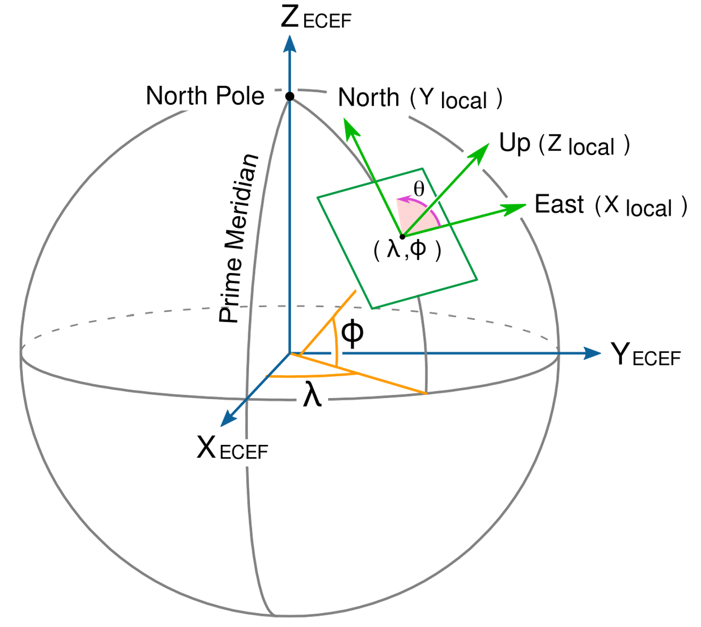
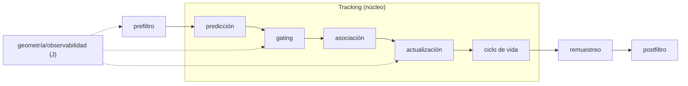
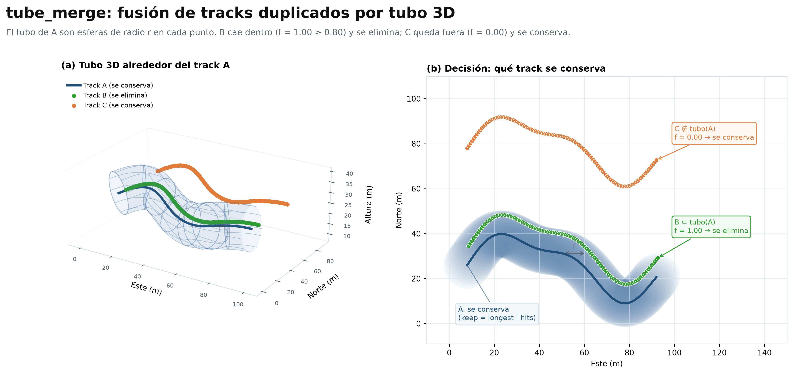

# NATO C-UAS Data Challenge

El ETL está en la raíz de este repo: `src/`, `config.yaml`, `requirements.txt`, `.venv`, `data/`, `reports/` y `out/`. El visor 3D está en `visualization/`.

## Pipeline de extremo a extremo

Diagrama de flujo interactivo y simplificado: desde los CSV originales hasta el Excel de entrega, con ETL, sistema ENU, prefiltro, asociación, tracker, postfiltro, clasificación, identificación, metadatos, evaluación y visor 3D. Los nodos enlazan a `src/`, `data/` y `visualization/`.

```mermaid
flowchart LR
    subgraph DATOS["Datos y ETL"]
        direction TB
        RAW["Datos originales<br/>CSV · GT · amigos · plantillas"]
        INV["Inventario<br/>Scenario/Iteration · split_group"]
        NORM["Normalización<br/>tiempo · sensor · coords · clase · serial · metadatos"]
        ENU["Sistema ENU<br/>origen = mediana de sensores<br/>WGS84 → ECEF → ENU"]
        DEDUP["Dedup SHA1<br/>Parquet · origins.json"]
        INT["Interim<br/>detections · GT · friends"]
    end
    subgraph TRACKING["Tracking"]
        direction TB
        SPL["Splits<br/>LOO por iteración"]
        PRE["Prefiltro<br/>inválidos · 0,0 · fusion · saltos"]
        ASO["Asociación<br/>gating · Húngaro · azimut"]
        TRK["Tracker<br/>Kalman ENU · lifecycle"]
        POST["Postfiltro<br/>plausibilidad · suavizado"]
    end
    subgraph ATRIBUTOS["Atributos"]
        direction TB
        CLS["Clasificación<br/>voto por track"]
        IDN["Identificación<br/>serial vs amigos"]
        MET["Metadatos<br/>modelo · protocolo · banda"]
    end
    subgraph ENTREGA["Evaluación y entrega"]
        direction TB
        EVA["Evaluación<br/>GOSPA · recalls"]
        SUB["Submit<br/>ENU → WGS84 · NEU"]
        XLS["Excel<br/>19 columnas · 100 ms · check"]
    end
    VIS["Visor 3D<br/>CSV planos"]

    RAW --> INV --> NORM --> ENU --> DEDUP --> INT
    INT --> SPL --> PRE --> ASO --> TRK --> POST
    POST --> CLS --> IDN --> MET --> EVA --> SUB --> XLS
    INT --> VIS
    VIS -.-> TRK

    click RAW "data/README.md" "Datos originales"
    click INV "src/etl.py" "Inventario y ETL"
    click NORM "src/etl.py" "Normalización"
    click ENU "src/geo.py" "Sistema ENU"
    click DEDUP "src/etl.py" "Deduplicación"
    click INT "data/README.md" "Tablas interim"
    click SPL "src/splits.py" "Splits"
    click PRE "config.yaml" "Prefiltro"
    click ASO "src/associate.py" "Asociación"
    click TRK "src/tracker.py" "Tracker"
    click POST "config.yaml" "Postfiltro"
    click CLS "src/classify.py" "Clasificación"
    click IDN "src/identify.py" "Identificación"
    click MET "src/metadata.py" "Metadatos"
    click EVA "src/evaluate.py" "Evaluación"
    click SUB "src/submit.py" "Submit"
    click XLS "out/" "Excel de entrega"
    click VIS "visualization/README.md" "Visor 3D"
```



## Datos

Cada miembro debe copiar los datasets originales dentro del repo, no enlazarlos desde otra ruta del PC:

```text
data/raw/test/  <- copia de Testing datasets
data/raw/eval/  <- copia de Evaluation datasets
```

`data/raw/` y `data/interim/` están ignorados por git; solo se versiona `data/README.md`.

## Convención de coordenadas

Hay dos sistemas y no se deben mezclar:

- Interno (ETL, tracker y visor): ENU/NEU (East-North-Up / North-East-Up: ejes locales en metros, tangentes al elipsoide WGS84 en el origen; ENU ordena Este, Norte, Arriba y NEU ordena Norte, Este, Arriba) con un origen fijo por iteración (un punto de referencia lat/lon/alt para pasar de WGS84 a metros locales). Ese origen es la mediana de las posiciones de sensor y se guarda en `data/interim/origins.json`.
- Entrega (Excel): WGS84 geodésico (WGS84: sistema geodésico mundial; `latitude`, `longitude`, `altitude_m`: grados y metros sobre su elipsoide) y covarianza NEU (matriz 3×3 de varianzas y covarianzas en ejes Norte-Este-Arriba, en m²) centrada en cada state vector (vector de estado: la posición estimada del dron en un instante, `[lat, lon, alt]` o `[n, e, u]`, junto con su incertidumbre), tal como pide `README_SubmissionTemplate.pdf` §1.2.

Cómo se calculan: en `src/geo.py` se pasa de WGS84 a ECEF (Earth-Centered, Earth-Fixed: coordenadas cartesianas 3D centradas en la Tierra, en metros) y de ahí a ENU/NEU rotando al plano tangente del origen. El template oficial describe la conversión de incertidumbre con el Jacobiano (matriz de derivadas parciales WGS84 → ECEF → NEU).

ENU es una aproximación tangente local: es válida para el escenario (unos pocos km) y no para distancias globales; para un uso global se usaría WGS84 o ECEF. En estos datos el ground truth real está dentro de ±4 km, así que el error de curvatura es despreciable.

Rangos: ENU mueve el ground truth en `n/e ≈ ±4 km` y `u ≈ 0–460 m`; los ecos a `±100–200 km` son outliers. En WGS84 el vuelo está en `lat ≈ 51,51°`, `lon ≈ 5,84°` (`1 m ≈ 9·10⁻⁶°` lat, `1,4·10⁻⁵°` lon). ECEF también usa metros, pero con valores de millones.



*Figura 1. ECEF y ejes locales Norte/Este/Arriba. Fuente: [Kkddkkdd, CC BY-SA 4.0, Wikimedia Commons](https://commons.wikimedia.org/wiki/File:ECEF_ENU_Longitude_Latitude_right-hand-rule.svg).*

NEU es el mismo esquema que ENU cambiando el orden de los ejes: `N-E-U` en vez de `E-N-U`.

Por qué se hace así:

- El tracker trabaja mejor en metros locales: Kalman, gating y covarianzas son más estables y comparables dentro de una iteración.
- El Excel no admite ese ENU interno: exige WGS84 y una covarianza NEU referida a cada state vector, no al origen fijo de la iteración.
- Por eso el ETL y el tracker usan ENU por iteración, pero `src/submit.py` convierte de vuelta con `enu_to_geodetic` (pasa ENU local a lat/lon/alt WGS84) y `covariance_neu_to_neu` (rota la covarianza NEU del origen de iteración al NEU de cada state vector) antes de escribir.

El origen por iteración es **decisión nuestra**, no una regla del concurso. La regla oficial es el formato de salida: WGS84 + NEU por state vector.

En los datos actuales, `S3` tiene tres iteraciones (`I1`, `I2`, `I3`) y sus orígenes difieren menos de 4 m, así que usar un origen por iteración es equivalente en la práctica a usar uno por escenario. Si en el futuro las iteraciones de un escenario se separan mucho, conviene pasar a origen por escenario o usar features relativas.

Verificación de la conversión interna → Excel:

```bash
python scripts/verify_submission.py
```

El script recorre las 9 plantillas, mockea tracks en ENU, los convierte a WGS84 + NEU por state vector, escribe un Excel real por iteración y comprueba cabecera, timestamps, covarianza y round-trip. Verificado: 9/9 plantillas pasan.

## Entorno

```bash
uv venv --python 3.11 .venv
source .venv/bin/activate
uv pip install -r requirements.txt
```

## Rehacer la base de datos

```bash
python -m src.cli all
```

Equivale a ejecutar, en orden:

```bash
python -m src.cli inventory # reports/inventory.csv y resumen
python -m src.cli etl       # data/interim/*
python -m src.cli splits    # folds sin fuga (leave-one-iteration-out: cada fold valida con una iteración completa y entrena con las demás, sin compartir vuelo)
python -m src.cli check     # valida plantillas Excel
python -m src.cli track     # tracks EKF en reports/tracks.parquet
python -m src.cli evaluate  # métricas de tracking en reports/
python scripts/diagnose_tracking.py  # diagnóstico GOSPA c=50/c=100, cobertura y duplicados
python -m src.cli submit    # Excel de entrega en out/ (9 iteraciones)
```

`submit` usa los tracks reales de `reports/tracks.parquet`; no hay datos mock. Los campos aún no implementados (clasificación, modelo, protocolo, banda e identidad) salen como `Unknown` hasta que exista su sidecar.

Para entrega usa solo los 3 de evaluación:

```bash
python -m src.cli submit --split eval
```

Genera `out/scenario_1_iteration_3.xlsx`, `out/scenario_2_iteration_1.xlsx` y `out/scenario_2_iteration_3.xlsx`; los otros 6 de `out/` son de test para prueba local.

`submit` mezcla sidecars opcionales por track si existen en `reports/`: `classification.parquet`, `identification.parquet` y `metadata.parquet`, con claves `split_group` y `track_id`. Si un sidecar no existe o está vacío, deja `Unknown` y continúa; no hay que tocar `classify.py`, `identify.py` ni `metadata.py`. El tracker no aporta clasificación final: deja `classification`/`identity` en `Unknown` y solo exporta pistas de trazabilidad (`sensor_class_hint`, `sensor_serial_hint`), que `submit` no usa. El `track_id` de salida es un UUID5 determinista por track y los seriales se ajustan a los valores admitidos por la plantilla.

Para reconstruir desde cero:

```bash
rm -rf data/interim reports out
python -m src.cli all
```

## Documentación de la base de datos

Detalle del ETL, esquema común, columnas, tablas, calidad y limitaciones: [`data/README.md`](data/README.md). Checklist completo de tratamientos de raw a interim: [`data/README.md#checklist-etl-de-raw-a-interim`](data/README.md#checklist-etl-de-raw-a-interim).

Salidas: `data/interim/` (tablas Parquet), `reports/` (auditoría y métricas) y `out/` (Excel de entrega).

## Etiquetas: detecciones ↔ ground truth

```bash
python -m src.cli labels    # tras `etl`; no forma parte de `all`
```

Empareja cada detección de `test` con el dron GT que estaba allí en ese instante ([`src/labels.py`](src/labels.py)), para tener etiquetas de entrenamiento (dron, RED/BLUE, modelo, ala fija/multirrotor) y medir los sensores. `eval` no tiene GT y queda como `no_gt`.

Cómo asigna:

1. Interpola la posición GT de cada dron al `ts_ms` de cada detección (±`time_tolerance_s`).
2. Error: distancia horizontal para sensores con posición, o error de azimut para los solo-rumbo. La altura no se usa porque los sensores mezclan datums verticales.
3. Por detección: dron con menor error / puerta del sensor (`labels.gate_m`, `labels.gate_deg`). Fuera de la puerta → `clutter`; dos drones dentro → `ambiguous`.
4. Votos por track crudo (`object_id`) y por serial. Si tienen suficientes detecciones y pureza (`vote_min_hits`, `vote_min_purity`), mandan sobre la detección suelta: serial > track > detección.

Salidas:

| Artefacto | Contenido |
|---|---|
| `data/interim/detection_labels.parquet` | una fila por detección (`row_uid`): `label_status` (`matched`, `ambiguous`, `clutter`, `unusable`, `no_gt`), `label_source`, `label_drone_key`, `label_err`, `label_color`, `label_is_blue`, `label_model`, `label_model_type`, `label_gt_static` |
| `reports/labels/summary.json` | recuentos y **avisos** de lo que no cuadra |
| `reports/labels/sensors.csv` | por sensor e iteración: % emparejado/ambiguo/clutter, error mediano y p90, y desfase temporal que minimiza el error |
| `reports/labels/tracks.csv` | pureza de cada track crudo (¿siempre el mismo dron?) |
| `reports/labels/serials.csv` | a qué dron cae cada serial y con qué pureza |
| `reports/labels/drones.csv` | por dron GT: detecciones por tipo de sensor y bandera `gt_static` |
| `reports/labels/class_vs_gt.csv` | clase que reporta cada sensor frente al tipo real del dron |

Avisos que genera hoy con los datos de test (revisar antes de entrenar):

- **Fusión (LJJX)**: el 100% de lo que empareja son drones BLUE. Usarla como feature filtra la identidad; excluirla.
- **Latencias**: LJJX va ~2 s tarde (error 20–30 m → 2–7 m al corregirlo) y el radar UXYJ ~3–4 s (60 → 20 m). Útil para el tracker.
- **5 GT estáticos** (Matrice 300, RQ y Skyranger en S3; Autel Evo 2 y FPV en S4): la etiqueta Dronetag no despega, pero algunos reciben cientos de detecciones.
- **Seriales**: algunos caen en varios drones (pureza 51–65%) y no se usan. `F5FHD233M00DEYG6` cae en el DJI3 en S1 y en un FPV en S3. `F45TB21BR1AE03FP` y `1581F45TB21BR1AE03FP` son el mismo dron con y sin prefijo.

## Tracking

El baseline está implementado en `src/prefilter.py` (prefiltro), `src/motion.py` ($F$ y $Q$), `src/geometry.py` (modelos de medida e información), `src/associate.py` (gating y asignación), `src/tracker.py` (EKF y ciclo de vida), `src/postfilter.py` (postfiltro opcional) y `src/resample.py` (remuestreo). El flujo es:



El prefiltro es un paso previo al tracking: limpia y descarta detecciones no plausibles. El núcleo del tracking son los pasos del recuadro: predicción, gating, asociación, actualización y ciclo de vida. El remuestreo y el postfiltro son adiciones que se mantienen en el diagrama: primero se remuestrea a la rejilla de salida y después se aplica el postfiltro sobre ella. El RTS futuro iría antes del remuestreo, porque necesita el estado y las covarianzas internas. El ciclo de vida entra en el núcleo porque decide qué tracks existen, se confirman o se eliminan; sin él no hay tracking multiobjeto, solo estimación aislada. La geometría/observabilidad no es un paso secuencial: es una capa transversal que alimenta el prefiltro (selección de sensores), el gating (criterio geométrico) y la actualización (diagnóstico de observabilidad).

El estado es 3D y de velocidad constante:

$$
x_k = [n, e, u, v_n, v_e, v_u]^\top
$$

### Prefiltro

Está en `src/prefilter.py` y se configura en el grupo top-level `prefilter:` de `config.yaml`. Se ejecuta antes de la predicción; su función genérica `preprocess_detections` delega en un método concreto (`range` o `none`).

La limpieza común elimina nodos de fusión (`fusion`, solo test), detecciones no-dron y medidas sin posición ni azimut utilizables. Además puede filtrar por configuración: clase (`drop_class_norm`), clase por sensor (`drop_class_norm_by_sensor`), tipo de sensor (`drop_sensor_types`, `keep_sensor_types`), confianza de detección global o por sensor (`min_det_conf`, `min_det_conf_by_sensor`, `max_det_conf_by_sensor`), confianza de clase (`min_class_conf`) y altitud (`max_alt_m`, `min_alt_m`). El método `range` descarta ecos de posición fuera del radio del escenario:

$$
r_k = \sqrt{n_k^2 + e_k^2} \leq r_{\max}
$$

donde $r_{\max}$ es `prefilter.max_range_m`. Las medidas solo-azimut no se filtran por rango porque no tienen posición.

El prefiltro podría ampliarse con outliers de saltos de velocidad o aceleración. Es un paso de limpieza de datos, no de estimación: no usa `F`, `Q`, `H` ni `R`.

**Fiabilidad de los scores y de los sensores** (`test`, etiquetas `matched` frente a `clutter`): la confianza de detección no es monótona en radar. Los valores `det_conf=1.0` son en gran parte el relleno de “no reportado” y solo el 5.8 % empareja, frente al 42 % de `0.95–0.99` y el 39 % de `0.90–0.95`; el AUC es 0.49. En cámara el AUC es 0.58 y en `class_conf` de radar 0.59, así que tampoco sirve como score fiable. La señal útil es el sensor y la clase: radar `Unknown` empareja el 2.9 %, `Fixed Wing` el 36 % y `Rotary Wing` el 48 %; cámara `Unknown` el 27 % frente al 54–60 % con clase dron; acústico `Unknown` el 73 %; RF `Unknown` el 5 % frente al 39 % `Rotary Wing`. Por sensor, la tasa de acierto varía de 0 % a 86 % (p. ej. `Delta_EGOI` 3 %, `Charlie_UXYJ` 43 %, `Bravo_WVFX` 96 %), así que el score por detección no basta: el tipo de sensor y la clase son más informativos.

### Movimiento: $F$ (modelo de movimiento) y $Q$ (ruido del proceso)

`src/motion.py` construye `F` y `Q`. `F` sale de la física de velocidad constante: la posición avanza con la velocidad y la velocidad se mantiene. `Q` modela que la velocidad no es perfectamente constante: se añade una aceleración eficaz $q$ (m/s²) con el bloque de ruido blanco.

`F` es la forma matricial de la dinámica de velocidad constante: la posición se actualiza como $p_k = p_{k-1} + v_{k-1}\,\Delta t$ y la velocidad se mantiene como $v_k = v_{k-1}$.

La derivación es la del modelo de **aceleración blanca discreta** (DWNA). Si en cada paso la aceleración es una variable aleatoria de media cero y varianza $q^2$, entonces el incremento de velocidad es $\Delta v = a\,\Delta t$ y el de posición es $\Delta p = a\,\Delta t^2/2$. Por tanto (por la definición de varianza y la bilinealidad de la covarianza: si $\mathbb{E}[a]=0$, entonces $\mathbb{E}[a^2]=\operatorname{Var}(a)$ y $\operatorname{Cov}(\alpha a,\beta a)=\alpha\beta\operatorname{Var}(a)$):

$$
\mathbb{E}[\Delta p^2] = q^2\frac{\Delta t^4}{4},
\qquad
\mathbb{E}[\Delta p\,\Delta v] = q^2\frac{\Delta t^3}{2},
\qquad
\mathbb{E}[\Delta v^2] = q^2\Delta t^2
$$

El modelo continuo equivalente (CWNA) usaría $\Delta t^3/3$, $\Delta t^2/2$ y $\Delta t$; aquí se usa el discreto porque el tracker avanza entre detecciones.

$$
F = \begin{bmatrix} I_3 & \Delta t I_3 \\ 0_3 & I_3 \end{bmatrix},
\qquad
Q = q^2 \begin{bmatrix} \frac{\Delta t^4}{4}I_3 & \frac{\Delta t^3}{2}I_3 \\ \frac{\Delta t^3}{2}I_3 & \Delta t^2 I_3 \end{bmatrix}
$$

La predicción es:

$$
x^- = F x^+, \qquad P^- = F P^+ F^\top + Q
$$

### Modelos de medida: $H$ (matriz de observación) y $R$ (ruido de las medidas)

Para sensores de posición (`radar`, `cyber`, `fusion`, `other`) (i.e. que reportan directamente la posición del dron, `n/e/u`) la medida ya es la posición:

$$
z = [n, e, u]^\top, \qquad
H = [I_3 \mid 0_3], \qquad
R = \operatorname{diag}(\sigma_n^2, \sigma_e^2, \sigma_u^2)
$$

Si falta `u`, se usa la variante 2D: `H` es $2\times6$ y `R` es $2\times2$.

`z` es la posición medida por el sensor en ENU; `H` selecciona las componentes de posición del estado; `R` es la covarianza del ruido de medida. Los $\sigma_n,\sigma_e,\sigma_u$ salen del error que reporta cada detección (`location_*Error`). Si falta, usamos un valor por tipo y eje calibrado con detecciones de `test` emparejadas al GT (`reports/labels/sensors.csv`), no ajustado a GOSPA. En `cyber`, si `xError`/`yError` vienen en grados, se convierten con $\sigma_n = yError \cdot 110540$ y $\sigma_e = xError \cdot 111320 \cdot \cos(lat)$ (`location_zError` se usa en metros); los valores en el tope (5000 m) se tratan como no reportados. Todo se recorta a `[0.5, 5000]` m. No hay un $\sigma$ por sensor individual: si llegan sensores nuevos, hay que recalibrar.

Para sensores solo-azimut (`rf`, `acústico`, `cámara`) la medida es el ángulo:

$$
h(x) = \operatorname{atan2}(e - e_s, n - n_s)
$$

$$
H = \left[-\frac{\Delta e}{r^2}, \frac{\Delta n}{r^2}, 0, 0, 0, 0\right],
\qquad
R = [\sigma_{az}^2]
$$

con $\Delta n = n - n_s$, $\Delta e = e - e_s$, $r^2 = \Delta n^2 + \Delta e^2$. La corrección es perpendicular a la línea de visión: ajusta la dirección, no la distancia. En el baseline no crean tracks; solo actualizan tracks ya existentes. Probamos crear tracks solo-azimut con un rango previo y empeoró GOSPA, así que queda desactivado (`initiate_from_bearing`).

`σ_az` no existe en la BD. Se toma de `tracker.measurement.sigma_az_deg`, calibrado con el error angular de las detecciones etiquetadas (`rf` 10°, acústico 3.5°, cámara 0.6°).

### Gating: $S$ (covarianza de la innovación) y $d^2$ (distancia de Mahalanobis)

Antes del Húngaro se descartan asociaciones improbables con la distancia de Mahalanobis:

$$
r = z - H x^-, \qquad
S = H P^- H^\top + R, \qquad
d^2 = r^\top S^{-1} r
$$

$$
\text{válida si } d^2 \leq \chi^2_{m,\alpha}
$$

donde $m$ es la dimensión de la medida y $\alpha$ el nivel de confianza (`tracker.gating.confidence`). Si `tracker.gating.chi2_gate` no es `null`, se usa ese umbral fijo en lugar del calculado. Además se aplica una puerta física de distancia para medidas de posición.

### Asociación: $C$ (matriz de coste)

El coste combina Mahalanobis con clase y serial:

$$
C_{ij} = d^2_{ij} + w_c \mathbb{1}[c_i \neq c_j] + w_s \mathbb{1}[s_i \neq s_j]
$$

$$
\min \sum_{ij} C_{ij} a_{ij}
\quad \text{s.a.} \quad
\sum_j a_{ij} \leq 1, \quad
\sum_i a_{ij} \leq 1, \quad
a_{ij} \in \{0,1\}
$$

Se resuelve con Húngaro (`scipy.optimize.linear_sum_assignment`) por sensor y por instante. Las asociaciones inválidas se excluyen con un coste grande.

### Actualización EKF: $K$ (ganancia de Kalman) y $P$ (covarianza del estado)

$$
K = P^- H^\top S^{-1}
$$

$$
x^+ = x^- + K r, \qquad
P^+ = (I - K H) P^- (I - K H)^\top + K R K^\top
$$

Se usa la forma de Joseph para mantener $P$ simétrica y definida positiva.

### Ciclo de vida

- `tentative`: track nuevo; no se emite. Pasa a `confirmed` al acumular `hits_to_confirm` (3) o `hits_to_confirm_unknown` (5) si nació de una detección `Unknown`.
- `confirmed`: se actualiza con detección; si no hay detección pasa a `coast`.
- `coast`: solo predice; se elimina si supera `max_coast_s` (3 s). Se emite mientras viva.
- Detección sin asignar con posición y corroboración multisensor (`initiation_min_sensors=2`) dentro de `initiation_window_s` (0.25 s) y `initiation_distance_m` (30 m): crea un `tentative`.
- Si `initiate_from_drone_only` está activo, solo inicia con clase de dron.
- Tracks duplicados dentro de `merge_distance_m` (100 m) se fusionan.

### Postfiltro

Es opcional y está en `src/postfilter.py`; se aplica después del remuestreo, sobre la rejilla de salida, y por defecto `tracker.postfilter.method: none`, así que no altera el baseline. Métodos disponibles:

- `fill_gaps`: reindexa cada track en la rejilla y interpola linealmente huecos de hasta `max_gap_ms`; la covarianza se arrastra.
- `moving_average`: suaviza `n,e,u` con media móvil centrada de ventana `smooth_window`:
  $$
  \bar{x}_k = \frac{1}{W}\sum_{i=-w}^{w} x_{k+i}
  $$
- `plausibility`: elimina el track si la velocidad entre muestras consecutivas supera `max_speed_mps`:
  $$
  v_k = \frac{\lVert p_k - p_{k-1}\rVert}{\Delta t} > v_{\max}
  $$
- `tube_merge`: fusiona tracks que caen dentro del tubo de otro. Para cada par con solape temporal ≥ `min_time_overlap_s`, aproxima el tubo por esferas de radio `radius_m` en los puntos de la rejilla y calcula la fracción del track corto que queda dentro del otro. Si supera `min_overlap_ratio`, se consideran el mismo y se conserva uno según `keep` (`longest`, `hits` o `lower_sigma`).



El orden importa: cada paso recibe la salida del anterior. El relleno de huecos no sustituye al remuestreo: el remuestreo predice con `F`, mientras que `fill_gaps` interpola observaciones. El suavizado y el filtro de plausibilidad son opcionales porque pueden sesgar o eliminar tracks reales; se activan solo tras validarlos en test. `tube_merge` tampoco está activo en el baseline: con `radius_m=25–50` solo fusiona 13 tracks y no cambia el GOSPA; con 200 m fusiona 28 y baja a 79.08, pero puede juntar drones reales cercanos. Una mejora futura es un suavizado RTS sobre el estado completo, que necesita guardar velocidad y covarianzas de predicción.

### Geometría y observabilidad: $J$ (matriz de información)

La información total de una ventana es:

$$
J = \sum_i H_i^\top R_i^{-1} H_i
$$

Sus autovalores dicen si la posición es observable:

- rango completo: se pueden estimar las tres direcciones;
- rango bajo: falta una dirección;
- $\kappa = \lambda_{\max}/\lambda_{\min}$: estabilidad numérica;
- ganancia marginal $\log\det(J + J_i) - \log\det(J)$: redundancia del sensor.

Es una capa transversal, no un paso secuencial: puede usarse como **prefiltro** de sensores antes del tracker, como criterio geométrico complementario en **gating** y como diagnóstico de la **actualización**. `src/geometry.py` implementa `diagnose_information` (diagnóstico) y `select_sensors` (prefiltro/diagnóstico: elige sensores antes del tracker maximizando `logdet`). El baseline no selecciona sensores: usa todos los válidos. La selección queda desactivada con `tracker.geometry.enabled`.

### Remuestreo

El tracker actualiza los tracks en los timestamps irregulares de las detecciones, pero la entrega exige una rejilla fija (`submission.grid_ms`, 100 ms). `src/resample.py` implementa `resample_tracks`, que lleva cada track a esa rejilla prediciendo con `F` y `Q` desde su última instantánea; se ejecuta antes del postfiltro:

$$
x(t) = F(\Delta t)\,x_k,
\qquad
P(t) = F(\Delta t)\,P_k\,F(\Delta t)^\top + Q(\Delta t)
$$

No hay corrección con medidas: es una predicción/coast sobre la rejilla. Tampoco interpola detecciones (eso sería `fill_gaps` del postfiltro). Así se obtiene posición y covarianza en cada timestamp de entrega.

### Salida de tracks

`reports/tracks.parquet` es la salida geométrica del tracker. `track_id` es genérico (`id_0`, `id_1`, …) y se reinicia en cada `split_group`; la iteración se identifica por `split_group`, no por el id. Cada `split_group` es una iteración/escenario independiente: el tracker se reinicia para cada uno y sus tracks son locales a esa iteración. El tracker no clasifica ni identifica: `classification`/`identity` salen `Unknown` y `classification_confidence=0.0`. Para trazabilidad sí exporta la última pista no nula del sensor en `sensor_class_hint` y `sensor_serial_hint`; no son la clase ni el serial finales y `submit` no las usa. El clasificador posterior escribe `reports/classification.parquet` con claves `split_group` y `track_id`; `submit` mezcla ese sidecar.

### Evaluación

GOSPA mide a la vez localización y cardinalidad. Sus componentes son: el error de localización de los pares emparejados ($d_i^p$), la penalización por objetivos del GT no detectados y la penalización por tracks falsos; $c$ trunca la distancia y $p$ controla la sensibilidad.

$$
\mathrm{GOSPA} = \left[
\sum_{\text{emparejados}} d_i^p
+ \frac{c^p}{p}(|X| - |\pi|)
+ \frac{c^p}{p}(|Y| - |\pi|)
\right]^{1/p}
$$

Para calcularlo, en cada iteración y timestamp se interpola el GT y se vuelve a emparejar tracks con GT mediante un Húngaro de evaluación. No es el Húngaro del tracker: aquel asocia detecciones a tracks con coste Mahalanobis/clase/serial; este asocia tracks ya estimados con GT usando distancia euclídea y trunca a $c$ (los pares a más de $c$ no cuentan como emparejados). Se suman las distancias de los pares válidos y $c^p/p$ por cada GT y cada track no emparejados, y se eleva a $1/p$. Después se promedian timestamps e iteraciones. Del mismo emparejamiento salen RMSE, recall (pares/GT) y tracks falsos (tracks no emparejados/tracks); los ID switches se cuentan por dron al cambiar de track. Se usa $p=2$ y $c$ en `evaluation.gospa_c_m`.

El challenge solo indica que usa GOSPA, sin fijar $p$, $c$, $\alpha$ ni el emparejamiento. Aquí se sigue la definición estándar de Rahmathullah et al. (2017) con $p=2$ y asignación óptima.

La métrica principal interna es **`GOSPA(c=50 m, p=2)`**. Con `c=50`, cada GT no detectado o track falso paga `c^2/2 = 1250`, así que un solo fallo de cardinalidad ya da `GOSPA >= 35.4 m`. `GOSPA(c=100 m, p=2)` se calcula solo como referencia histórica y **no se mezcla** con la principal. Los valores absolutos dependen de `c` y solo son comparables entre modelos evaluados con el mismo `c`.

### Diagnóstico reproducible

`python scripts/diagnose_tracking.py` escribe `reports/tracking_diagnostics.csv` y `.json` con GOSPA `c=50`/`c=100`, descomposición, cobertura, duplicados y vida de tracks. La cobertura GT→detección se calcula sobre detecciones crudas, antes del prefiltro. No toca el tracker ni `config.yaml`.

**Baseline actual** (hash `0f3e186e9e6e7886`): prefiltro con `drop_class_norm: [Unknown]`, `min_det_conf: 0.9` y `drop_sensor_types: [cyber]`.

| Grupo | GOSPA c=50 | GOSPA c=100 | Recall c=50 | Falsos c=50 | ID switches |
|---|---:|---:|---:|---:|---:|
| S1:I1 | 69.6 | 131.2 | 0.173 | 0.436 | 8 |
| S2:I2 | 78.1 | 144.6 | 0.171 | 0.520 | 9 |
| S3:I1 | 84.1 | 157.9 | 0.083 | 0.793 | 28 |
| S3:I2 | 82.5 | 153.1 | 0.115 | 0.763 | 12 |
| S3:I3 | 70.4 | 133.9 | 0.125 | 0.776 | 17 |
| S4:I4 | 89.8 | 167.2 | 0.151 | 0.473 | 9 |
| **Media** | **79.1** | **148.0** | **0.136** | **0.627** | — |

La descomposición completa (RMSE, GT/ts, tracks/ts, missed/ts, false/ts) está en `reports/tracking_diagnostics.csv`; no se repite aquí.

La métrica `c=50` es la principal. El baseline a `c=100` queda solo como referencia histórica.

**Hallazgos que explican el GOSPA**:

- Cobertura GT→detección de posición: 16–39 % a ≤50 m y 28–54 % a ≤100 m; precisión de detección a ≤50 m: 1–14 %. El detalle por grupo está en `reports/tracking_diagnostics.csv`.
- Cardinalidad: el 95 % del GOSPA es penalización por GT no detectado y tracks falsos; solo el 5 % es error de localización. El 72 % de los tracks no se acerca nunca a ≤50 m de un GT; el 28 % sí.
- Solo-azimut: 0–88 % del GT tiene un bearing a ≤5°, pero solo 0–5 % tiene ≥2 sensores; la triangulación simultánea no es viable.
- Tracks: 514 IDs en total (103 en `test`), mediana de vida 10 s; ~99.9 % `coast` y ~0.1 % `confirmed`; no se emiten `tentative`.
- Líneas verticales: no son sensores direccionales. Son saltos de altitud del radar. Sin prefiltro había 290 tracks con saltos >20 m en 100 ms y 245 de los 275 saltos >50 m eran radar; con el prefiltro actual bajan a 77 tracks y 49 saltos >50 m. El radar tiene 19 % de `|u|>200 m` y máximos >11 km. Los solo-azimut no tocan `u`.
- Líneas radiales: sí vienen de los sensores direccionales (cámara/acústico/RF). El 40 % de los tracks está a <2° de un sensor solo-azimut; en tracks largos y fantasma sube al 63 % a <5°. Al no observar rango, el track se desliza sobre la visual del sensor.
- Duplicados: 65 196 copias extra detectadas; el ETL ya las reduce a 161.
- Altitud: GT `u` 3–123 m; tracks con medias 139–593 m y máximos >11 000 m.

### Probado

| Cambio | GOSPA c=50 | Recall | Falsos | Decisión |
|---|---:|---:|---:|---|
| Baseline inicial | 89.42 | 0.118 | 0.821 | referencia |
| Dedup + velocidad >90 m/s | 89.15 | 0.118 | 0.817 | mantener |
| No emitir `tentative` | 87.10 | 0.109 | 0.811 | mantener |
| `max_coast_s=3` | 85.41 | 0.107 | 0.787 | mantener |
| Iniciación multisensor (0.25 s, 30 m, 5 hits Unknown) | 83.78 | 0.107 | 0.778 | baseline anterior |
| Sigmas calibrados (labels) | **87.76** | 0.111 | 0.817 | mantener por robustez |
| Sigmas MAD (`479bfab`) | 88.84 | 0.107 | 0.830 | descartar: labels mejora |

El rerun controlado de la calibración MAD con el tracker actual da 88.84, no el 88.23 histórico; aquel artefacto era anterior al commit `479bfab`. Evidencia en `reports/sigma_mad_vs_labels/`.

Probado y revertido: `merge_distance` 15/25/50, `hits_to_confirm` 2/4, `chi2_gate` 16.3, `q`/`σ_v`/`use_altitude`, y evaluar solo `confirmed`. El detalle está en `reports/`.

### Limitaciones

- `fusion` se excluye siempre del tracker (`is_test_only`).
- 87 filas `cyber` de `eval:Dataset_II:S2:I1` no traen `u`; se actualizan en 2D y `u` se propaga con covarianza grande.
- `σ_az` es un default por tipo, no una medida del sensor; se calibró con las detecciones etiquetadas.
- El baseline no modela sesgo de sensor ni correlación entre sensores.
- **Iniciación**: 2 sensores dentro de 0.25 s y 30 m; los `Unknown` necesitan 5 hits para confirmar. Corregido.
- **Merge**: `merge_distance_m=100` puede fusionar drones reales. En S3:I1 el 52 % de los timestamps tiene dos GT a menos de 100 m; aun así, 100 da mejor GOSPA que 15/25/50.
- **Evaluación**: no se emiten `tentative`; `coast` se emite hasta `max_coast_s=3`. `_positions` usa `nan_to_num(u=0)`.
- **Solo-azimut**: en el baseline no inicia tracks. La triangulación simultánea casi nunca es posible (0–5 % de timestamps con ≥2 sensores a ≤5°); la vía probada es tracking temporal con prior de rango, y empeora GOSPA. Sus actualizaciones sí deforman tracks existentes y generan líneas radiales.
- **Altitud radar**: `u` es la componente más ruidosa; filtrar `|u|>200 m` empeora el GOSPA (87.87) porque también quita detecciones verdaderas. El problema no es solo el filtro, sino el modelo de medida.
- **Tracks fantasma**: 259 tracks falsos en el baseline actual, con 142 `Fixed Wing` y 117 `Rotary Wing`; los más largos superan 250 s. Son radar con clase dron, no `Unknown`.
- **S4:I4** es el grupo más difícil: 24 % de cobertura de posición a ≤50 m y 2 % de bearing a ≤5°. Sin otra fuente de datos, no es realista bajarlo a 50 m.

### Decisiones y notas

- **Métrica principal**: `GOSPA(c=50 m, p=2)`; `c=100` solo como referencia histórica.
- **README = fuente única de verdad**: lo obsoleto se borra o reescribe; el histórico vive en git.
- **Un cambio cada vez**, validación en folds de `test`, `eval` solo al final.
- Estado 3D CV; no se emiten `tentative`; `coast` hasta 3 s.
- Prefiltro `range` a 5 km más `drop_class_norm: [Unknown]`, `min_det_conf: 0.9` y `drop_sensor_types: [cyber]`; ETL con dedup natural y filtro de velocidad >90 m/s.
- Iniciación con 2 sensores en 0.25 s y 30 m; `Unknown` requiere 5 hits.
- `σ_az` calibrado con labels; `q`, gating y `merge_distance` ya están probados.
- Solo-azimut probado y descartado como mejora; flag `initiate_from_bearing` desactivado.
- Postfiltro `none` y geometría desactivada en el baseline.

### Referencias

- Kalman, R. E. (1960). A New Approach to Linear Filtering and Prediction Problems. *Journal of Basic Engineering*, 82(1), 35–45.
- Rahmathullah, A. S., García-Fernández, Á. F., & Svensson, L. (2017). Generalized Optimal Sub-Pattern Assignment Metric. *20th International Conference on Information Fusion (FUSION)*, 1–8.
- Bar-Shalom, Y., Li, X.-R., & Kirubarajan, T. (2001). *Estimation with Applications to Tracking and Navigation*. Wiley. Cap. 6: modelo de velocidad constante y ruido de proceso DWNA.
- Blackman, S. S., & Popoli, R. (1999). *Design and Analysis of Modern Tracking Systems*. Artech House. Cap. 6: filtros y asociación.
- Särkkä, S. (2013). *Bayesian Filtering and Smoothing*. Cambridge University Press. Cap. 4: discretización del modelo CV; cap. 9: suavizado RTS.
- ResearchGate. *Single-target state estimation using Kalman filter and RTS smoother*. https://www.researchgate.net/figure/Single-target-state-estimation-using-Kalman-filter-and-RTS-smoother_fig4_320182941

### Estado actual

- **Hecho**: diagnóstico reproducible, dedup natural, filtro de velocidad >90 m/s, `status` en rejilla, calibración de movimiento/gating, no emitir `tentative`, `max_coast_s=3` e iniciación multisensor temporal. Prefiltro configurable por clase, sensor, confianza y altitud.
- **Baseline**: **79.09** a `c=50` con `drop_class_norm: [Unknown]`, `min_det_conf: 0.9` y `drop_sensor_types: [cyber]`; sin prefiltro era 87.76 y con sigmas ajustados a GOSPA 83.78.
- **Pendiente**: reducir tracks fantasma de radar con clase dron y congelar para `eval`. Solo-azimut ya está probado y descartado como mejora; sus actualizaciones siguen generando líneas radiales.

## Clasificación

Pendiente. El tracker no asigna clase final y deja `classification=Unknown`; solo exporta `sensor_class_hint` para trazabilidad. La salida genérica y el contrato del sidecar `reports/classification.parquet` están en [Salida de tracks](#salida-de-tracks). `src/classify.py` solo normaliza la clase del sensor para asociación/fusión interna.

## Identificación

...

## Metadatos

...

## Train / validación

- `test` = 6 iteraciones con ground truth → entrenamiento/validación supervisada.
- `eval` = 3 datasets sin ground truth → solo inferencia; nunca entrenar ni calibrar con ellos.
- Dividir las **detecciones** (filas) por `split_group` (iteración completa), nunca por fila individual: todas las filas de una iteración van juntas a train o a validación. `data/interim/splits.json` ya trae 6 folds leave-one-iteration-out sin solape, y `reports/split_folds.csv` permite auditarlo.

Por qué: las filas de una misma iteración comparten vuelo, sensores y tiempo. Un split por fila metería el mismo dron/instante en train y validación, inflando las métricas. Separando por iteración, se valida en un vuelo/escenario no visto.

- Ajustar escaladores, calibración y umbrales solo con folds de train; congelar antes de `eval`.
- `fusion` (`LJJX`) es solo de test: excluirlo o marcarlo con `is_fusion_node` / `is_test_only` para evaluación.
- La lista de amigos solo sirve para identidad en inferencia.

No hay umbrales mínimos para las métricas que debamos superar, pero los siguientes son valores típicamente razonables.

| Área | Métrica oficial | Peso | Rango típico | Objetivo interno | Baseline actual |
|---|---|---:|---|---|---|
| Tracking | GOSPA ($c=50$ m, $p=2$) | 0.4 | 20–100 m | < 50 m | 73.1–106.4 m (media 87.8) |
| Clasificación | Recall | 0.2 | 0.60–0.90 | > 0.75 | pendiente |
| Identificación | Recall | 0.1 | 0.50–0.90 | > 0.70 | pendiente |
| Fusión | Acierto de metadatos | 0.3 | 0.50–0.80 | > 0.70 | pendiente |

Los valores “típicos” son orientativos y dependen del dataset y del umbral de GOSPA. Los criterios internos se fijan con los folds de `test` y se congelan antes de `eval`.

## Visualización

El visor 3D está en [`visualization/`](visualization/README.md). Se ejecuta aparte, con sus propias dependencias y una carpeta plana de CSV:

```bash
cd visualization
pip install -r requirements.txt
python app.py --data /ruta/a/csv
```

Para ver las trayectorias del tracker frente a las reales (líneas de error, elipses de incertidumbre, detecciones coloreadas por etiqueta y comparación de dos runs):

```bash
python app.py --iteration "../data/raw/test/Scenario 1/Iteration 1" \
              --interim ../data/interim --tracks ../reports/tracks.parquet [--tracks-b otro/tracks.parquet]
```

También se puede arrastrar un `tracks.parquet` al panel **Cargar datos** del visor para superponerlo sin relanzar; usa el `split_group` de la iteración abierta y `data/interim` para el origen ENU y el GT. Informe HTML con lo mismo para todas las iteraciones de test: `python scripts/compare_report.py` (→ `reports/compare_tracks.html`). Detalle en [`visualization/README.md`](visualization/README.md).

## Configuración

Todos los parámetros están en `config.yaml`. `prefilter`, `tracker` y `postfilter` son grupos top-level separados: el prefiltro y el postfiltro no son parámetros internos del EKF. La métrica principal de tracking es `GOSPA(c=50 m, p=2)`; `gospa_c_reference_m: 100.0` se usa solo como comparación histórica.

El diagnóstico reproducible del baseline se obtiene con `python scripts/diagnose_tracking.py` y queda en `reports/tracking_diagnostics.csv` y `.json`.

### Valores por defecto y su justificación

Criterio: un default se acepta si sale de una medida del dataset, de una cota física o geométrica, o si está tuneado en `test` y se marca como tal.

- **`σ` de sensor**: reportado por detección; si falta, calibrado con detecciones de `test` emparejadas al GT. No se ajusta con GOSPA.
- **Movimiento, gating y ciclo de vida**: ajustados en `test`.
- **Pesos de asociación y `max_tentative_misses`**: pendientes de ajustar.
- **Postfiltro y geometría**: implementados pero inactivos en el baseline; **clasificación**: placeholder.
- **Límites de `σ`, radio y velocidad**: cotas físicas/geométricas del escenario.
- **Prefiltro**: activo en el baseline; quita `Unknown`, `cyber` y detecciones con `det_conf<0.9`. El resto de filtros queda disponible pero desactivado.
- **Scores de sensor**: `det_conf` y `class_conf` no son fiables por detección; el tipo de sensor y la clase normalizada sí discriminan.

La calibración de `σ` usa `test` (único GT) y no se ajusta con GOSPA; sin prefiltro cuesta 87.76 frente a 83.78 del baseline anterior, aceptado por robustez. Con el prefiltro actual el baseline es 79.09. Con datos o sensores nuevos hay que recalibrar.

## TODO

Hecho: auditoría, diagnóstico reproducible, README sincronizado, `evaluation.gospa_c_m=50`, dedup natural, filtro de velocidad, `status` en la rejilla, calibración de movimiento/gating, ciclo de vida e iniciación multisensor. Pendiente:

- Reducir los tracks fantasma largos de radar con clase dron; el siguiente paso es tocar confirmación/asociación, no el prefiltro.
- Solo-azimut como validación de tracks de posición (usar bearings para confirmar/descartar), no como fuente de tracks.
- `u` ausente: no hay nulos en tracks ni en GT, así que `nan_to_num(u=0)` no se activa; no es una medida necesaria.
- Robustecer `σ` con enfoque jerárquico (prior por tipo + partial pooling por `sensor_id`), validación NIS/NEES y colas pesadas, con validación leave-one-sensor-out.
- `reports/labels/` también da latencias, clutter, pureza de tracks, etiquetas de clasificación/identidad y GT estáticos: útiles, pero no críticos ahora.
- Validar `σ_az` con residuos y valorar UKF/CA/IMM y selección geométrica.
- Añadir RTS como postfiltro opcional; solo reduce localización, no cardinalidad.
- Ajustar `tube_merge` si se quiere usar: con radios conservadores no cambia GOSPA; con radios grandes puede fusionar drones reales.
- Congelar `config.yaml`, ejecutar `eval` una vez, generar los 3 Excel y cerrar el README.
- Resolver clasificación, identificación y metadatos: votar por track, decidir amigo/enemigo por serial y rellenar la ficha técnica (modelo, protocolo, banda).
- `det_conf` ya filtra en el prefiltro; queda conectarlo al coste de asociación o al peso de `R`, y `class_conf` al voto de clasificación.
- Añadir tests automáticos con pytest.
- Crear el documento compartido (p. ej. Drive) con brainstorming de familias de modelos por tarea, incluyendo **prefiltro**, **postfiltro**, **feature engineering**, reglas analíticas, **modelos**, reducción/filtrado, zoo de candidatos, **SOTA** e ideas a mantener/descartar.
